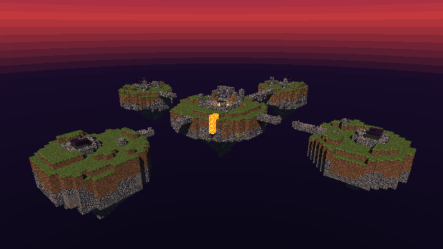

# Minecraft EggWars Diorama

A static, Minecraft 1.8-inspired diorama rendered with a custom CPU raytracer written in Rust.

**Author:** Alejandro Pérez — **Student ID (Carné):** 24136

## Description

This project renders the aftermath of an EggWars match: five procedurally generated floating
islands, partially destroyed bridges, broken obsidian defenses, open chests, embedded arrows,
surviving and destroyed eggs, and lava under a sunset-to-night sky.

**It is not a playable Minecraft clone.** There is no player, physics or gameplay. The scene is
static and is explored from the outside with an orbital camera or a free spectator camera. All
image computation (ray generation, intersections, shadows, reflection, refraction) runs on the
CPU; no GPU is used.

## Preview



## Demonstration video

[](https://youtu.be/FagbaJLKZds)

Link: <https://youtu.be/FagbaJLKZds>

The video shows the initial view of the five islands, orbiting and zooming, a close-up of the
central ruin (lava, chests, arrows, glass and obsidian), the damaged bridges and defenses,
switching to the free camera, and variation between seeds.

## Technologies

- Stable Rust (2024 edition); no `unsafe` code.
- Only dependency: `raylib` 6.0.0, used solely for the window, input, timing and for displaying
  the framebuffer already computed on the CPU (`src/app/app.rs`). It is not used for any
  rendering computation.
- Custom CPU raytracer: `Vec3`, `Ray`, AABB, `VoxelGrid`, materials, lighting and environment.
- Multithreading with the standard library (`std::thread::scope`, `AtomicUsize`, `Mutex`).
- 16×16 PPM P6 textures loaded by project code. The original classic Minecraft-style PNG files
  are converted offline with `scripts/prepare_assets.sh`.

## Architecture

```text
Procedural World
      |
      v
VoxelGrid + AABB Objects
      |
      v
Hybrid DDA / AABB Traversal
      |
      v
CPU Raytracer
      |
      v
Framebuffer
      |
      v
Raylib Window
```

| Module | Responsibility |
| --- | --- |
| `math`, `ray`, `geometry` | `Vec3`, `Ray`, AABB with slab intersection |
| `voxel` | Global dense `VoxelGrid`, `BlockType`, 3D DDA traversal |
| `world` | Deterministic noise, islands, five-island arena, bridges, structures and decorations |
| `scene` | Hybrid voxel + AABB queries (closest hit and occlusion) |
| `material` | Canonical materials, PPM textures, normal map, `MaterialId`/`TextureId` |
| `lighting`, `environment` | Ambient, directional and point lights; procedural sky |
| `render` | Recursive tracing, tiles and parallel workers, framebuffer |
| `camera` | `OrbitalCamera`, `FreeCamera` and the `ViewCamera` trait |
| `app` | Window, input and presentation with Raylib |

## Design decisions

| Decision | Rationale |
| --- | --- |
| Project-owned `Vec3` and `Ray` | Control over numerical conventions and no external dependencies. |
| AABB-first geometry | Blocks, chests, arrows and eggs are axis-aligned boxes, which suits the pixelated style. |
| One global dense `VoxelGrid` | A single contiguous structure for all five islands; it stores only the block identity (1 byte). |
| 3D DDA traversal | Visits only the cells a ray crosses instead of testing every block. |
| Hybrid voxel/AABB rendering | Terrain and structures are voxels; small props are AABBs. The closest hit wins. |
| Deterministic seeds | Stateless per-domain hashing (no shared RNG): the same seed always produces the same scene. |
| CPU-owned textures, nearest-neighbor | Preserves the pixelated look; sampling does not depend on Raylib. |
| `MaterialId` / `TextureId` | Materials and textures are shared by identifier, with no per-block data duplication. |
| Bounded recursive reflection | Fixed maximum depth (`MAX_RAY_DEPTH = 3`) to control cost. |
| Snell refraction and Fresnel | Glass (IOR 1.5) blends reflection and refraction using Schlick's approximation. |
| Directional and point lighting | A directional sun plus finite point lights for the lava. |
| Hard shadows | One shadow ray per light; simple and predictable. |
| Emissive lava | Material-owned emission plus one representative point light (not one per voxel). |
| Cobblestone normal mapping | Normal map derived offline from its own texture; affects local lighting only. |
| Procedural skybox | Sunset-to-night evaluated in world space; it is the single miss path for all rays. |
| Deterministic tile rendering | Each pixel uses its global coordinates; the image does not depend on order or thread count. |
| Multithreading with `std::thread::scope` | Threads claim 16×16 tiles with an atomic counter; no pools and no `unsafe`. |
| Spatial grouping of decorative AABBs | 8 groups with exact bounds skip rays that miss them; output is identical to the linear scan. |
| Orbital and free spectator cameras | Both implement `ViewCamera`; the renderer is the same for both. |

## EggWars scene

- Four 16×16 outer islands and one 24×24 central island, with procedural grass, dirt and rock
  terrain and deterministically distributed ores (coal, iron, gold, diamond).
- Four bridges in different states: complete (North), damaged (East), incomplete (West) and
  severed (South).
- Nine-block obsidian egg defenses: intact (North), damaged (West), breached (East) and
  destroyed (South).
- Eggs: one survives on the West island; the North island's egg is sealed inside its intact
  defense. Shell fragments lie on the East and South islands.
- A central ruin with an obsidian-inlaid floor, partial walls, glass windows, two open chests and
  arrows embedded in walls, defenses and bridges; debris is scattered across the arena.
- A 2×2 lava pool in the ruin, with a warm point light, and a lava spill over the central
  island's south edge.
- Procedural sunset-to-night sky.

The storytelling is environmental: broken bridges, breached defenses and abandoned objects imply
an assault that has already ended, with one egg that held out and others that did not.

## Materials

| Material | Effect it demonstrates |
| --- | --- |
| Grass | Per-face textures (top, side, bottom) with the biome tint applied offline. |
| Cobblestone | Normal mapping derived from its own texture. |
| Obsidian | Recursive reflection on a dark surface. |
| Glass | Snell refraction with Fresnel composition. |
| Lava | Self-emission and local lighting through a point light. |

These are reasonable real-time approximations, not a physically exact simulation.

## Rubric requirements

| Requirement | Implementation | Status |
| --- | --- | --- |
| CPU raytracing | Custom renderer, no GPU | Implemented |
| Procedural terrain of at least 16×16 | 16×16 and 24×24 islands from a `u64` seed | Implemented |
| Five textured materials | Grass, cobblestone, obsidian, glass, lava | Implemented |
| Reflection | Obsidian, recursive | Implemented |
| Refraction | Glass, Snell + Fresnel | Implemented |
| Normal mapping | Cobblestone | Implemented |
| Emissive material | Lava, with a point light | Implemented |
| Skybox | Procedural sunset/night environment | Implemented |
| Orbital rotation and zoom | `OrbitalCamera` | Implemented |
| Free camera (extra) | `FreeCamera` spectator | Implemented |
| Parallel rendering and optimization | Tiles + threads, `VoxelGrid` + 3D DDA, spatial grouping | Implemented |
| Complex, attractive scene | Five-island EggWars diorama | Implemented |
| Demonstration video | [YouTube](https://youtu.be/FagbaJLKZds) | Delivered |

## Running

Requires stable Rust and Cargo (macOS; Raylib is built as a dependency). The texture PPM files
are already in `assets/textures/`; `scripts/prepare_assets.sh` is only needed to regenerate them
from `assets/source/` (it uses macOS `sips`).

```bash
cargo run --release -- --eggwars --seed 1847
cargo run --release -- --eggwars --seed 42
cargo test
```

The default `--eggwars` seed is 42. The same seed always generates the same scene. On startup,
the initial image is saved to `output/eggwars_seed_<seed>.ppm`. Other diagnostic modes:
`cargo run --release` (five-block showcase), `-- --voxel-diagnostic` and
`-- --procedural-island [--seed <u64>]`.

## Controls

| Orbital camera (default) | |
| --- | --- |
| Arrow keys | Orbit (horizontal and elevation) |
| `W` / `S` or mouse wheel | Zoom in / out |
| `C` | Switch to the free camera |
| `Esc` | Quit |

| Free camera (spectator, noclip) | |
| --- | --- |
| `W` / `S` | Move forward / backward |
| `A` / `D` | Strafe left / right |
| `Space` / `Shift` | Move up / down |
| Mouse | Look around (the cursor is captured only in this mode) |
| `C` | Return to the orbital camera, restored exactly as it was |
| `Esc` | Quit |

The free camera starts at the orbital camera's exact position and direction. It has no physics,
gravity or collision.

## Performance

Local measurements (Apple M3 Pro, 11 CPUs, release mode, seed 1847); not universal benchmarks.

| Item | Value |
| --- | --- |
| Internal / window resolution | 640×360 / 1280×720 (2× scale, nearest-neighbor) |
| Initial view, automatic thread count | ≈ 10 ms |
| Initial view before the lava pool and spill, 1 / 4 / auto threads | 61 / 16 / 8 ms |
| Automated tests | 743 passing |

Frames with no camera change are not re-rendered. More historical detail in
[docs/DEVELOPMENT.md](docs/DEVELOPMENT.md).

## Known limitations

- Glass and lava cast opaque shadows; there is no nested-medium tracking (glass touching another
  block can show that block's interior face).
- Fixed recursion depth (3).
- Decorative geometry is axis-aligned (no tilted lids or angled arrows).
- No antialiasing.
- No gameplay, by design.
- No camera collision: the orbital camera can enter an island and the free camera passes through
  everything (noclip).
- The North island's egg is sealed and is not instantiated in the scene.

## Development history

Mission summaries, decisions and historical measurements (in English, with the project's original
notes): [docs/DEVELOPMENT.md](docs/DEVELOPMENT.md).

## Authorship

Alejandro Pérez — Student ID (Carné): 24136. Academic computer graphics project.
